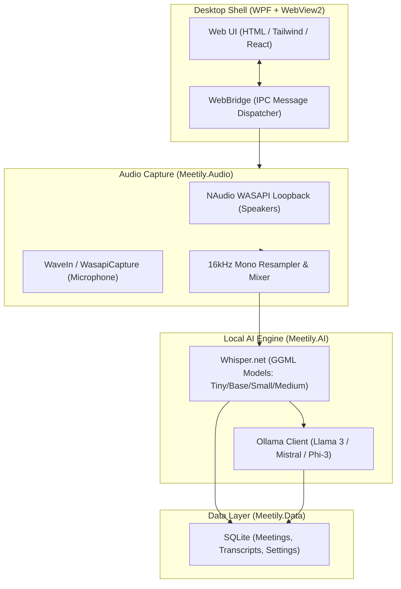

# Meetily.NET 🎙️🤖

> **100% Local, Privacy-First AI Meeting Assistant for Windows**  
> Built with **.NET 8**, **WPF + WebView2**, **NAudio (WASAPI)**, **Whisper.net**, and **Ollama**.

Meetily.NET is a clean, native .NET port and Windows implementation of [Meetily](https://github.com/Zackriya-Solutions/meetily). It captures your system audio (what other participants say on Zoom, Microsoft Teams, Google Meet) and your microphone simultaneously, transcribes speech with local Whisper, and generates structured meeting notes and action items using local LLMs (via Ollama) — **all completely offline and private**.

---

## ⚡ Why the .NET Port?

The original Meetily uses Tauri (Rust + Next.js). On Windows, building Tauri requires the Rust toolchain and heavy Microsoft C++ Build Tools (MSVC), making local rebuilds and customizations difficult.

**Meetily.NET solves this:**
* **Zero C++ / Rust compilers required:** All dependencies (audio capture, native Whisper bindings, SQLite, WebView2) are distributed as pre-compiled NuGet packages.
* **Native Windows WASAPI Loopback:** Uses `NAudio` for rock-solid system audio recording.
* **Automatic Cloud Builds:** Included GitHub Actions workflow compiles and releases the standalone Windows `.exe` on every push.

---

## 🏗️ Architecture



---

## ✨ Key Features

1. **Dual Audio Stream Capture:** Records speaker output (WASAPI Loopback) + microphone simultaneously mixed into 16kHz mono audio.
2. **Offline Speech-to-Text:** Embedded `Whisper.net` with automatic model downloading (`tiny`, `base`, `small`, `medium`).
3. **Structured AI Summaries:** Connects to local **Ollama** (`http://localhost:11434`) to extract:
   - Executive Summary
   - Action Items (with checkboxes)
   - Key Discussion Topics & Decisions
4. **Local SQLite Storage:** Meetings, transcripts, and notes are indexed and searchable locally.
5. **Modern WebView2 UI:** Clean, responsive, dark-mode dashboard with real-time audio meters and streaming transcript updates.

---

## 🚀 Quick Start

### Option 1: Download Pre-built Executable (No compiling!)
1. Go to **[Releases](https://github.com/zerokid/meetily-dotnet/releases)** or the **[Actions Tab](https://github.com/zerokid/meetily-dotnet/actions)**.
2. Download `Meetily-Windows-x64` and the pre-uploaded **`ggml-base.bin`** from [Release v0.1.0](https://github.com/zerokid/meetily-dotnet/releases/tag/v0.1.0).
3. Extract and run `Meetily.App.exe`.

---

### Option 2: Run from Source (.NET 8 SDK required)

#### Prerequisites:
* Windows 10 / 11 (x64)
* [.NET 8 SDK](https://dotnet.microsoft.com/download/dotnet/8.0)
* (Optional) [Ollama](https://ollama.com/) running locally for AI summaries (`ollama run llama3`)

#### Run:
```bash
# Clone the repository
git clone https://github.com/zerokid/meetily-dotnet.git
cd meetily-dotnet

# Restore packages & run
dotnet run --project src/Meetily.App/Meetily.App.csproj
```

---

## 📂 Project Structure

```
meetily-dotnet/
├── .github/workflows/
│   └── build-and-release.yml   # Automatic Windows .exe builder
├── src/
│   ├── Meetily.Core/           # Domain models, service interfaces, app configuration
│   ├── Meetily.Audio/          # NAudio WASAPI loopback + mic mixer
│   ├── Meetily.AI/             # Whisper.net transcription + Ollama LLM client
│   ├── Meetily.Data/           # SQLite database service & full-text search
│   └── Meetily.App/            # WPF desktop shell, WebView2 host & web frontend
├── Meetily.sln                 # Visual Studio Solution
└── README.md
```

---

## 🛠️ Configuration

Meetily.NET saves its local database and models to:
`%LOCALAPPDATA%\Meetily\`

* **Models Directory:** `%LOCALAPPDATA%\Meetily\models\`
* **Recordings Directory:** `%LOCALAPPDATA%\Meetily\recordings\`
* **Database File:** `%LOCALAPPDATA%\Meetily\meetily.db`

---

## 📜 Credits & License

* Inspired by [Meetily](https://github.com/Zackriya-Solutions/meetily) by Zackriya Solutions.
* Released under the [MIT License](LICENSE).
